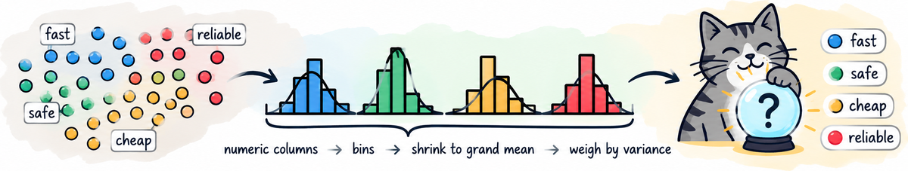

<p align="center"></p>

<div align="center">

[lua 101](lua101.md) ·
[lua, more](luamore.md) ·
[tab.lua](tab.md) ·
[tab-eg.lua](tab-eg.md) ·
[license](https://github.com/timm/tab/blob/main/LICENSE.md)

</div>

# tab-eg.lua

vim: set ts=2 sw=2 sts=2 et cc=75 :
tab-eg.lua: the rigs.  A split is a seed, not a file: `rint` is
Park-Miller and stays under 2^53, so lua, python and lisp all
shuffle a table into the same order.  Only scores reach the disk.
Everything here is idempotent: work already cached is never
redone (pass force=y to insist).
usage: luajit tab-eg.lua go=nb     file=f.csv
       luajit tab-eg.lua go=rmeans file=f.csv
       luajit tab-eg.lua go=splits file=f.csv  (what seed s gives)

```lua
package.path = (arg[0]:match"^(.*)/" or ".") .. "/?.lua;" .. package.path
local min = require "tab"
if setfenv then setfenv(1, min) end          -- tab's _ENV is ours too
local _ENV = min
the = cli()                         -- tab's options, off our cli

cache = os.getenv"CACHE"           -- ../tab-dev/cache, if ,/sh
if not cache or cache == "" then   -- "" is true in lua, so an
  cache = (os.getenv"HOME" or "~") .. "/tmp/cache" end -- empty
                                   -- CACHE must be caught here
reps  = 20
```

## files

`exists(f:fun)` is f a file we can read?

```lua
function exists(f,    h)
  h = io.open(f)
  if h then h:close() end
  return h ~= nil end
```

`home(f:fun)` cache dir, mirroring moot's tree

```lua
function home(f)
  return cache .. "/" ..
         (f:match"moot/(.+)%.csv$" or f:match"([^/]+)%.csv$") end
```

## cache

`pair(tbl:TAB, s:str)` rep s's halves of tbl, by seed

```lua
function pair(tbl,s,    tr,te)
  the.seed = 1234567891 + s
  tr, te = tbl:split()
  return tbl:clone(tr), tbl:clone(te) end
```

`scored(file:file, who, fun, what)` once

```lua
function scored(file,who,fun,what,    dir,f,h,tbl,t0,line,ok)
  dir = home(file)
  f   = ("%s/%s.csv"):format(dir, who)
  if exists(f) and not the.force then return f end
  os.execute("mkdir -p " .. dir)
  tbl = Tab(file)
  h    = io.open(f, "w")
  h:write("rep,secs," .. what .. "\n")
  for s = 1, reps do
    t0 = os.clock()
    ok, line = pcall(fun, pair(tbl, s))     -- a broken csv is a skip
    if not ok then h:close(); os.remove(f); error(line, 0) end
    h:write(("%d,%.4f,%s\n"):format(s, os.clock() - t0, line)) end
  h:close()
  return f end
```

## learners

`bayes(tr, te)` learn tr, guess all of te

```lua
function bayes(tr,te,    nb,col,bag,trb)
  trb, bag = tr:clone(tr.rows, "bin"), Bag()
  nb, col = Nb(trb, trb.rows), trb.klass
  for _, row in order(tr:clone(te.rows, "bin").rows) do
    bag:tally(row[col.at], nb:guess(row)) end
  return ("%.1f,%.1f,%.1f,%.3f"):format(bag:score()) end
```

`goal(tbl:TAB)` regression: that one column, in

```lua
function goal(tbl,    col)
  col = (the.file or ""):find"/regression/"   -- its own units, which is
        and #tbl.y == 1 and getmetatable(tbl.y[1]) == NUM and tbl.y[1]
  if col then
    return function(row) return tonumber(row[col.at]) or col.mu end end
  return function(row) return tbl:ydist(row) end end -- else ydist: 0 is
                                    -- best whatever col.w says, and mae
                                    -- then compares across sets
function rmeans(tr,te,    y,lim)    -- the frugal arm: budget labels
  y   = goal(tr)
  lim = the.budget - the.check
  return score(Rmeans(tr, head1(tr.rows, lim), y), te, y) end
```

`rmeansall(tr, te)` the rich arm: every train row

```lua
function rmeansall(tr,te,    y)
  y = goal(tr)
  return score(Rmeans(tr, tr.rows, y), te, y) end
```

`head1(rows:list, n:int)` rows' first n, or all of them

```lua
function head1(rows,n,    out)
  out = {}
  for j = 1, (#rows < n and #rows or n) do out[j] = rows[j] end
  return out end
```

`score(model, te, y:fun)` where its top 5 sat, and its mae

```lua
function score(model,te,y)
  return ("%.3f,%.6g"):format(top(model, te, y), mae(model, te, y)) end
```

`top(model, te, y:fun)` where its top 5 landed

```lua
function top(model,te,y,    ys,rows,g,best)
  ys, rows, g = {}, {}, {}
  for n, row in order(te.rows) do
    ys[n], rows[n], g[row] = y(row), row, model:guess(row) end
  for n, row in order(rows, function(a,b) return g[a] < g[b] end) do
    if n > the.check then break end
    best = (not best or y(row) < best) and y(row) or best end
  for n, v in order(ys, lt) do
    if v == best then return 100 * (n-1) / max(1, #ys-1) end end
  return 100 end
```

`mae(model, te, y:fun)` mean error of model's guesses

```lua
function mae(model,te,y,    num)
  num = Num()
  for _, row in order(te.rows) do
    num:add(abs(model:guess(row) - y(row))) end
  return num.mu end
```

## reading it back

`dirs(kind)` every cached set of this kind

```lua
function dirs(kind,    out,h)
  out, h = {}, io.popen("find " .. cache .. "/" .. (kind or "") ..
                        " -name '*.csv' 2>/dev/null")
  for line in h:lines() do out[line:match"^(.*)/"] = true end
  h:close()
  return sorted(out) end
```

`sorted(t:list)` t's keys, in order

```lua
function sorted(t,    u)
  u = {}
  for k in pairs(t) do u[#u + 1] = k end
  table.sort(u)
  return u end
```

`readcol(dir, who, what)` one result column

```lua
function readcol(dir,who,what,    f,out,at,n)
  f = io.open(("%s/%s.csv"):format(dir, who))
  if not f then return nil end
  out = {}
  for line in f:lines() do
    n = 0
    for s in line:gmatch"[^,]+" do
      n = n + 1
      if not at and s == what then at = n end
      if at and n == at then out[#out + 1] = tonumber(s) end end end
  f:close()
  return #out > 0 and out or nil end
```

`mid(xs:list)` the median of xs

```lua
function mid(xs,    ys)
  ys = map(xs, same)
  table.sort(ys)
  return #ys == 0 and 0 or (#ys % 2 == 1 and ys[(#ys+1)/2]
                            or (ys[#ys/2] + ys[#ys/2+1]) / 2) end

function versus(kind,who1,who2,what,big,    w,t,l,ma,mb,xs,ys)
  w, t, l, ma, mb = 0, 0, 0, {}, {}
  for _, dir in order(dirs(kind)) do
    xs, ys = readcol(dir, who1, what), readcol(dir, who2, what)
    if xs and ys then
      ma[#ma+1], mb[#mb+1] = mid(xs), mid(ys)
      if Same(xs, ys):ok()             then t = t + 1
      elseif (mid(xs) > mid(ys)) == big then w = w + 1
      else                                  l = l + 1 end end end
  print(("%-11s %-10s %7.3f   %-10s %7.3f   %d win %d tie %d loss")
        :format(kind, who1, mid(ma), who2, mid(mb), w, t, l)) end
```

## start up

`.splits()` what seed s gives, for checking

```lua
function eg.splits(    tbl,tr,te)
  tbl = Tab(the.file)
  tr, te = pair(tbl, tonumber(the.rep) or 1)
  print(#tr.rows, #te.rows, table.concat(tr.rows[1], ",")) end
```

`.report()` what the cache says, so far

```lua
function eg.report()
  versus("classify",   "nb",     "lgbm",      "acc",  true)
  versus("regression", "rmeans", "lgbm",      "mae",  false)
  versus("regression", "rmeans", "rmeansall", "rank", false)
  versus("optimize",   "rmeans", "rmeansall", "rank", false) end

function eg.nb()
  print(scored(the.file, "nb", bayes, "acc,pd,pf,d2h")) end

function eg.rmeans()
  print(scored(the.file, "rmeans", rmeans, "rank,mae")) end

function eg.rmeansall()
  print(scored(the.file, "rmeansall", rmeansall, "rank,mae")) end

if (arg and arg[0] or ""):find"tab%-eg%.lua$" then
  ok, err = pcall(eg[the.go])       -- a broken csv is a skip, not a stop
  if not ok then
    io.stderr:write(the.file, ": ", tostring(err), "\n") end end
return _ENV
```
